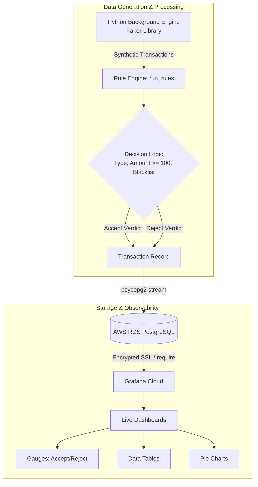

# 🏦 Real-Time Banking Fraud Detection & MLOps Pipeline


## 📌 Overview
This repository contains a streaming data pipeline designed for real-time observability. It utilizes a Python background engine to generate mock financial transactions, evaluates them against a custom fraud-detection rule engine, pushes the resulting data to an AWS RDS PostgreSQL database, and visualizes live metrics using highly secure Grafana dashboards.

## 🏗️ System Architecture & Data Flow



### Data Flow Breakdown
* **Data Simulation:** A persistent Python background process leverages the `Faker` library to continuously generate synthetic banking transactions with varied metadata.
* **Rule Evaluation:** Generated records are immediately passed to a custom `run_rules` Python function that evaluates them against hardcoded thresholds (e.g., transaction type, amounts >= $100, and blacklisted status).
* **Decision Tagging:** The rule engine appends a definitive "Accept" or "Reject" status to the transaction payload based on the evaluation logic.
* **Database Streaming:** The tagged transaction records are streamed continuously via `psycopg2` to a remote AWS RDS PostgreSQL database.
* **Live Visualization:** Grafana Cloud connects to the RDS instance using an encrypted SSL connection (`require`), running continuous SQL queries to populate gauges, pie charts, and real-time transaction tables on the dashboard.

## 💻 Tech Stack
* **Language:** Python (Pandas, Psycopg2, Faker)
* **Cloud Database:** AWS RDS PostgreSQL
* **Observability:** Grafana (Stat, Pie Chart, and Bar Chart panels)
* **Security & Config:** Environment variables via `python-dotenv`, Encrypted SSL

## 🚀 Getting Started

### Prerequisites
* Python 3.8+
* PostgreSQL client tools
* Grafana Cloud Account
* AWS Account (for RDS setup)

### Installation & Setup

1. **Clone the repository:**
   ```bash
   git clone https://github.com/Buggie15/grafana-project.git
   cd grafana-project
   ```

2. **Set up the environment:**
   Create a `.env` file in the root directory and add your database credentials:
   ```ini
   DB_HOST="your_aws_rds_endpoint"
   DB_NAME="your_database_name"
   DB_USER="your_database_user"
   DB_PASSWORD="your_database_password"
   DB_PORT="5432"
   ```

3. **Install dependencies:**
   ```bash
   pip install -r requirements.txt
   ```

4. **Run the data streaming engine:**
   ```bash
   python main.py
   ```
   *(Note: Replace `main.py` with the actual name of your entry script if different).*

## 👨‍💻 Author
**Osho**  
Machine Learning & AI Automation Engineer  
[LinkedIn](https://www.linkedin.com/in/oshobugie) | [GitHub](https://github.com/Buggie15)
